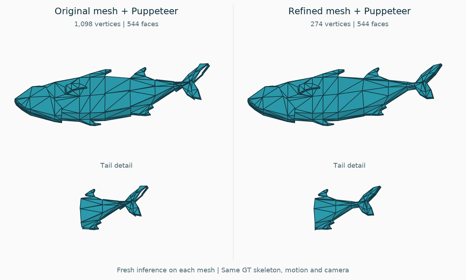

<div align="center">

<h1>Deformation-Aware Mesh Refinement<br>for Robust Automatic Rigging</h1>

<p><strong>Hyun Wook Kim · Sanglim Han · Hak Gu Kim</strong><br>Chung-Ang University</p>

<p>
  <a href="#overview">Overview</a> ·
  <a href="#installation">Installation</a> ·
  <a href="#quick-start">Quick Start</a> ·
  <a href="#data-preparation">Data Preparation</a> ·
  <a href="#documentation">Documentation</a>
</p>

</div>

## Overview

Duplicate vertices in rigged meshes can receive different skinning weights and
separate during deformation. Our method combines surface orientation partitioning,
density-weighted skinning fusion and vertex merging to refine these duplicates
without relocating vertices or modifying the skeleton.


This CPU-only implementation takes a triangle mesh and existing skinning weights
as input. No training or pretrained checkpoint is required. It provides KDE and
Mean fusion, plus Skin L1, DE, FPR, CD and NME evaluation.

## Skinning Comparison

Puppeteer is run separately on the original and refined meshes with the same
GT skeleton. Both predictions are animated with identical joint motion and camera.
A wireframe overlay shows triangle boundaries and surface separation.



[Watch/download MP4](examples/axl2_fish/comparison.mp4) ·
[Protocol and source credits](examples/axl2_fish/README.md#fresh-inference-video)

## Installation

Tested with Python 3.8.10, NumPy 1.24.4, SciPy 1.10.1 and PyYAML 6.0.3.

```bash
git clone https://github.com/Budy123/Deformation-Aware-Mesh-Refinement.git
cd Deformation-Aware-Mesh-Refinement

python3.8 -m venv .venv
source .venv/bin/activate
python -m pip install -r requirements.txt
python -m pip install .
```

An existing Python environment can also be used. CUDA and Blender are not required.

## Quick Start

Run the bundled [AXL 2.0 Fish1 example](examples/axl2_fish/README.md), with real
skinning predictions and a GT reference. No dataset download or model inference
is needed:

```bash
python -m mesh_refinement refine \
  --input examples/axl2_fish/input.npz \
  --output outputs/fish/refined.npz \
  --config config/fusion_config.yaml

python -m mesh_refinement evaluate \
  --input examples/axl2_fish/input.npz \
  --refined outputs/fish/refined.npz \
  --output outputs/fish/metrics.json
```

The commands produce a refined NPZ and a JSON metric report. Choose fresh output
paths when repeating a run; existing files are not overwritten.

This example reduces 1,098 vertices to 274 while retaining all 544 faces.
The original asset is by Quaternius (CC0); the AXL-derived data is included
with its CC BY 4.0 attribution. See the [example source and license](examples/axl2_fish/README.md#source-and-license).

## Data Preparation

Download the datasets from their official releases:

| Dataset | Download | Converter input |
| --- | --- | --- |
| RigNetv1 | [Preprocessed data](https://drive.google.com/file/d/1-B6hJ4423rw1LrTForHp7oaG5qRAbJx3/view) ([source](https://github.com/zhan-xu/RigNet#data)) | ZIP or extracted folder with `obj_remesh/` and `rig_info_remesh/` |
| AXL 2.0 | [Preprocessed NPZ files](https://huggingface.co/datasets/Seed3D/Articulation-XL2.0/tree/main) | `articulation_xlv2_train.npz` or `articulation_xlv2_test.npz` |

Convert the downloaded data together with the corresponding predicted weights:

```bash
python scripts/prepare_data.py --dataset rignetv1 \
  --input data/ModelResource_RigNetv1_preproccessed.zip \
  --predictions-dir predictions/rignetv1 --output-dir data/prepared/rignetv1

python scripts/prepare_data.py --dataset axl2 \
  --input data/articulation_xlv2_test.npz --trust-axl-pickle \
  --predictions-dir predictions/axl2_test --output-dir data/prepared/axl2_test
```

The converter writes numeric per-mesh NPZ files ready for `refine` and `evaluate`.
Predictions use Puppeteer's `<sample_id>_skin.npy` format. To use dataset GT
weights as input instead, replace `--predictions-dir ...` with `--use-gt-weights`;
this is a GT-input run, not the paper's predicted-input evaluation.
See [data preparation](docs/data_preparation.md) for prediction setup, a complete
single-mesh example and output details. For other data, see the [NPZ schema](docs/usage.md#input-data).

## Configuration

Edit [config/fusion_config.yaml](config/fusion_config.yaml) to change fusion
settings. The default configuration matches the recorded experiment settings.
Use `--fusion mean` to compare uniform averaging with the same refinement pipeline.

## Repository Structure

```text
config/             YAML settings
docs/               Usage, evaluation and testing reference
examples/           Licensed real-mesh input with predictions and source credits
mesh_refinement/    Refinement, fusion, metrics and CLI
scripts/            Dataset conversion
tests/              Unit and CLI regression tests
licenses/           Retained third-party licenses
```

## Documentation

| Guide | Contents |
| --- | --- |
| [Data preparation](docs/data_preparation.md) | Dataset downloads, conversion and predicted/GT weight inputs |
| [Usage](docs/usage.md) | Input/output formats, configuration, Python API and CLI options |
| [Evaluation](docs/evaluation.md) | Metric definitions, pose sampling and reproduction scope |
| [Testing](docs/testing.md) | Test commands, numerical checks and source provenance |

Apart from the single licensed example, datasets and predictions are not included.
The package processes numeric
NPZ files; it does not run auto-rigging models or import/export FBX.

## Citation

```bibtex
@misc{kim2026deformation,
  title={Deformation-Aware Mesh Refinement for Robust Automatic Rigging},
  author={Kim, Hyun Wook and Han, Sanglim and Kim, Hak Gu},
  year={2026},
  note={Manuscript}
}
```

## Acknowledgements and License

The research pipeline builds on [Puppeteer](https://github.com/Seed3D/Puppeteer),
with evaluation conventions based on [UniRig](https://github.com/VAST-AI-Research/UniRig).
Neither project is a runtime dependency of this package.

Code is released under [Apache 2.0](LICENSE). The bundled example has its own
[asset and dataset licenses](examples/axl2_fish/README.md#source-and-license).
See [NOTICE.md](NOTICE.md) for attribution.
