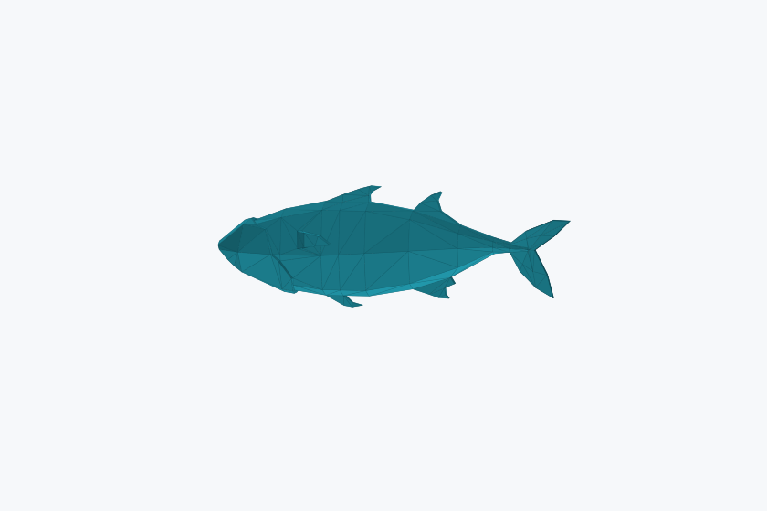
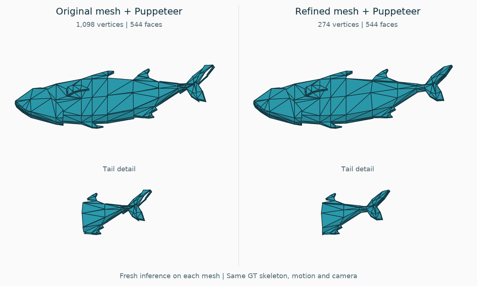

# AXL 2.0 Fish1 example



This is a real rigged mesh from Articulation-XL2.0, not generated geometry or
artificially perturbed weights. The bundled numeric NPZ is ready to use without
downloading the dataset or running a prediction model.

## Contents

- `input.npz`: 1,098 vertices, 544 triangles, 8 joints, cached Puppeteer
  predictions (`skin`), source annotations (`gt_skin`) and the GT skeleton.
- `mesh.obj`: the same rest-pose geometry, for inspection in a mesh viewer.
- `preview.png`: a rendering of that geometry, without source textures.
- `provenance.json`: source links, conversion details and array hashes.
- `comparison.gif` / `comparison.mp4`: original/refined mesh comparison with
  fresh skinning predictions on each mesh.
- `video_provenance.json`: inference settings, checkpoint hashes, motion and scores.

Run from the repository root after installation:

```bash
python -m mesh_refinement refine --input examples/axl2_fish/input.npz \
  --output outputs/fish/refined.npz --config config/fusion_config.yaml
python -m mesh_refinement evaluate --input examples/axl2_fish/input.npz \
  --refined outputs/fish/refined.npz --output outputs/fish/metrics.json
```

With the default configuration, refinement retains all 544 faces and reduces
the vertex count from 1,098 to 274 without moving the retained vertices.
Expected CD is 0, FPR is 1 and NME is 0. This is one selected demonstration,
not a dataset-average result or evidence of general outlier robustness.
The supplied predictions are unchanged; no noise was added to create an effect.
Evaluation uses 64 poses, seed 321 and sample index 0 by default. It is not a
claim to reproduce the paper's full dataset/pose aggregation.

## Fresh inference video



[Watch/download MP4](comparison.mp4)

The video follows **original mesh → fresh Puppeteer prediction → refinement →
fresh Puppeteer prediction on the refined mesh**. The right-hand result uses
the new refined-mesh prediction, not the fused skinning weights. The GT skeleton
is identical in both inference inputs; GT weights are used only for evaluation.

Both inference runs use the same `puppeteer_skin_w_diverse_pose_depth1.pth`
checkpoint, depth 1, seed 0, `max_joints=256`, batch size 1 and native post-filter.
The displayed motion is one prescribed swim cycle, shared by both results;
it is not an original animation clip or a pose selected by an error search.
Full-mesh and tail views use common framing over all frames and both methods.
Wireframe edges are drawn over the surface to make triangle boundaries and
separation visible. Predictions, motion and camera are unchanged by this overlay.
The numeric NPZ's existing cached weights are unchanged and are not these new
predictions. Native point sampling is stochastic, so a seed is not a promise
of bitwise-identical reruns.

For these fresh predictions, Skin L1 changes from 0.026602 to 0.026192, while
64-pose DE changes from 0.008864 to 0.009937 (seed 321, sample index 0). The
video illustrates the structural difference; it does not claim that every
skinning/deformation metric improves after re-inference. Settings, hashes and
unrounded scores are in [video_provenance.json](video_provenance.json).

## Source and license

**Original asset:** Fish1 by **Quaternius**, from the
[Animated Fish Pack](https://quaternius.com/packs/animatedfish.html), published
under [CC0 1.0](https://creativecommons.org/publicdomain/zero/1.0/).
The source asset is public-domain-dedicated; the provider's license notice is
also available on the [author's original release](https://opengameart.org/content/animated-fish).

**Dataset version and processing:** [Articulation-XL2.0](https://huggingface.co/datasets/Seed3D/Articulation-XL2.0),
by the MagicArticulate/Puppeteer authors, published under
[CC BY 4.0](https://creativecommons.org/licenses/by/4.0/).
The numeric mesh/annotation derivative, preview and comparison video retain
that attribution and CC BY 4.0 notice; they are **not** relicensed as Apache 2.0.
The original Quaternius asset remains CC0.

Dataset sample ID: `c76bfca7-6e53-50d1-a0e9-ff7cd6690866` (main training split).
The dataset's [metadata](https://huggingface.co/datasets/Seed3D/Articulation-XL2.0/blob/main/meta_Articulation_XL_2.0.csv)
links this record to the [source Fish1.blend](https://github.com/ThibaultBus/ICreate-2023-Ocean-de-promesses/blob/d007a9122cc2414330a92fc6b4fecca6d7ea1750/Unity/ICreate-2023-Ocean-de-promesses/Assets/Fish/Animated%20Fish%20Pack%20by%20%40Quaternius/Blends/Fish1.blend).
The model weights were predicted by [Puppeteer](https://github.com/Seed3D/Puppeteer)
on the original dataset mesh with its GT skeleton fixed.

**Changes for this example:** converted the published record to pickle-free
numeric NPZ, expanded and normalized the source GT rows as in the experiment
loader, and attached the existing raw-mesh predictions. Original vertex/face
order, coordinates and joint hierarchy are preserved. OBJ and preview contain
geometry only; textures and animation clips are not included. No endorsement
by the asset or dataset authors is implied.
